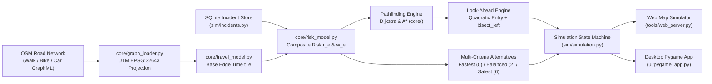
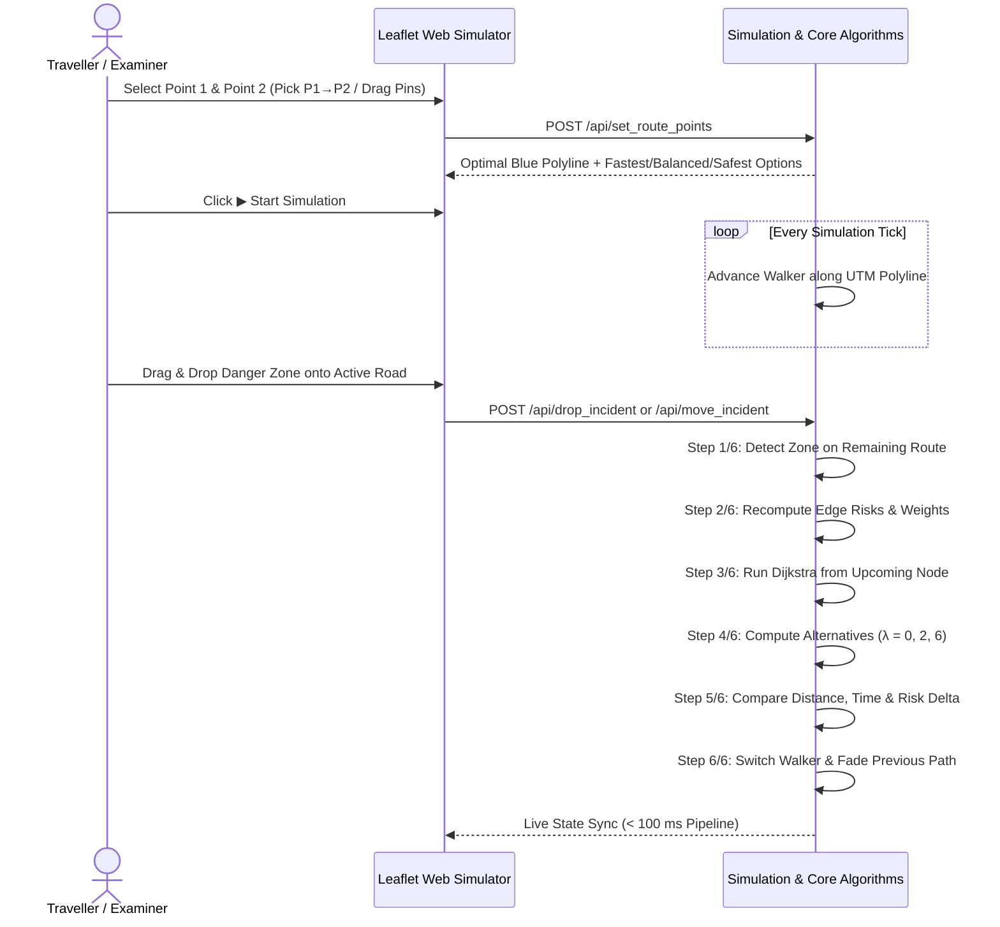
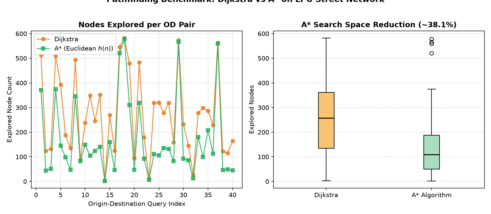
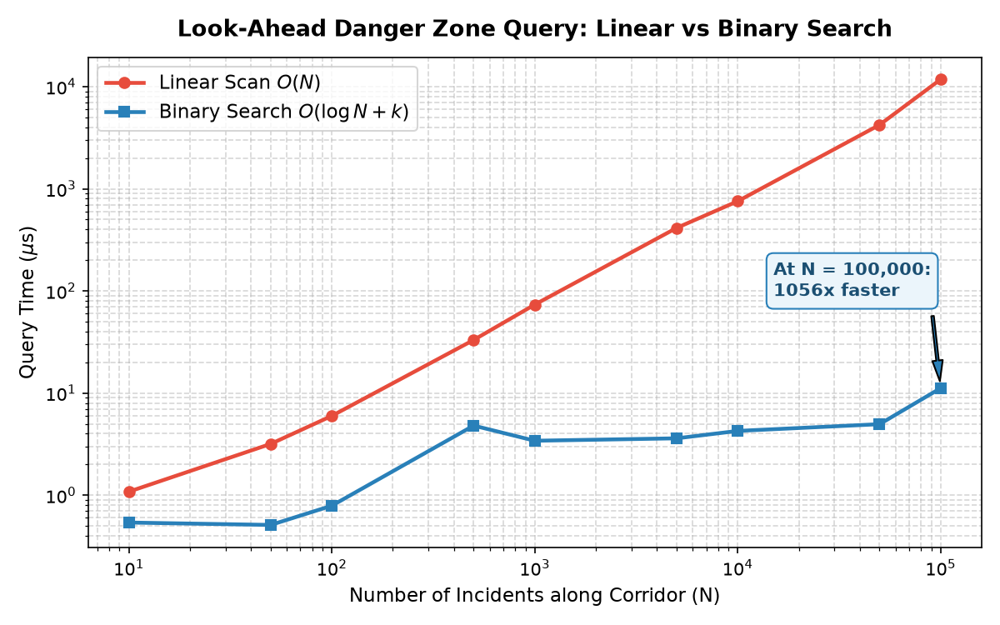

<div align="center">

# SafeRoute — Real-Time Hazard-Aware Navigation & Campus Route Optimization Engine

[](https://www.python.org/)
[](https://osmnx.readthedocs.io/)
[](tests/)
[](#quick-start)
[-6366F1?style=for-the-badge)](Project%20Report/CSM21612517025.pdf)
[](LICENSE)

**A modular, real-time hazard-aware routing engine combining custom Dijkstra, admissible A\*, exponential-decay spatial risk modeling, multi-criteria route alternatives, and quadratic + binary-search look-ahead rerouting.**

[Main Algorithms (Viva Folder)](01_Main_Algorithms_Viva/README.md) · [Simulation & Viewers](02_Simulator_And_Apps/README.md) · [Final Project Report](Project%20Report/CSM21612517025.pdf) · [Viva Guide](Project%20Report/SafeRoute_Viva_Preparation_Guide.pdf)

</div>

---

## Key Highlights

- **From-Scratch Graph Search (No Black-Box Routing):** Custom `heapq` min-heap implementations of **Dijkstra's Algorithm** and **A\* Search** (`core/dijkstra.py`, `core/astar.py`) handling OpenStreetMap `MultiDiGraph` parallel edges in projected UTM metric coordinates (`EPSG:32643`).
- **Composite Spatial Risk Scoring:** Evaluates every road segment against nearby hazards using mode sensitivity weights, linear zone falloff, exponential historical decay ($180$-day half-life), logarithmic accident hotspot accumulation, and strict $40\text{ m}$ vehicle road-closures.
- **Multi-Criteria Route Options ($\lambda \in \{0, 2, 6\}$):** Computes **Fastest** ($\lambda = 0$), **Balanced** ($\lambda = 2$), and **Safest** ($\lambda = 6$) routes concurrently and lets the traveller switch dynamically on click or hotkey (`R`).
- **Two-Point Route Selection (`Point 1 → Point 2`):** Click **Pick P1**, **Pick P2**, **Pick P1 → P2** (2-click interactive picker), **Swap**, or drag `START`/`GOAL` map pins to immediately compute danger-aware blue routes between any two locations.
- **Live Drag-and-Drop Hazard Rerouting:** Drag any hazard icon from the toolbar (`Accident`, `Flood`, `Unsafe`, `Work`, `Damage`) or reposition existing danger zones directly onto active roads mid-simulation to trigger the **6-Step Real-Time Reroute Pipeline** in `< 100 ms`.
- **Two Clean Project Perspectives:** Organized explicitly into **[Part 1: Main Algorithms (`01_Main_Algorithms_Viva/` + `core/`)](01_Main_Algorithms_Viva/README.md)** for fast academic/viva walkthroughs and **[Part 2: Simulator, SQLite Store & Viewers (`02_Simulator_And_Apps/` + `sim/`, `tools/`, `ui/`)](02_Simulator_And_Apps/README.md)** for interactive visualization.

---

## Two-Part Project Organization

| Part | Directory | Audience / Purpose | Entry Point |
|---|---|---|---|
| **Part 1 — Main Algorithms** | [`01_Main_Algorithms_Viva/`](01_Main_Algorithms_Viva/README.md) & [`core/`](core/) | Core pathfinding, risk scoring, look-ahead & mathematical formulas for presentation & viva | `python 01_Main_Algorithms_Viva/run_core_algorithms_demo.py` |
| **Part 2 — Simulation & Apps** | [`02_Simulator_And_Apps/`](02_Simulator_And_Apps/README.md) & [`sim/`](sim/), [`tools/`](tools/), [`ui/`](ui/) | Interactive localhost Leaflet web app, desktop Pygame app, state machine, SQLite store | `python tools/web_server.py --port 8000` |

<details>
<summary><strong>Full Repository Directory Layout</strong></summary>

```text
SafeRoute/
├── 01_Main_Algorithms_Viva/          # Teacher & viva isolated guide + standalone runner
│   ├── README.md                     # Core algorithm index & math summary
│   ├── ALGORITHM_EXPLANATION_FOR_VIVA.md  # 30-second viva Q&A cards per module
│   └── run_core_algorithms_demo.py   # Runs Dijkstra, A*, Risk, Lambda & Look-ahead directly
├── 02_Simulator_And_Apps/            # Simulation layer & applications guide
│   └── README.md
├── core/                             # Pure Algorithmic Engine (no UI dependencies)
│   ├── graph_loader.py               # OSMnx GraphML loader + EPSG:32643 UTM node snapping
│   ├── travel_model.py               # Walk/Bike/Car speed & base travel-time assignment
│   ├── risk_model.py                 # Composite edge risk scoring & make_weight_fn
│   ├── dijkstra.py                   # Custom Dijkstra shortest path + lazy deletion + trace
│   ├── astar.py                      # Admissible Euclidean/v_max A* shortest path
│   ├── lookahead.py                  # Quadratic line-circle intersection + bisect_left index
│   ├── router.py                     # Multi-modal comparisons, reroute() & lambda alternatives
│   └── search_benchmark.py           # Experimental Dijkstra vs A* & bisect vs linear benchmarks
├── sim/                              # Simulation Engine & Persistence
│   ├── simulation.py                 # 7-state FSM, 6-step reroute pipeline, endpoint control
│   ├── walker.py                     # Continuous polyline kinematic interpolator
│   ├── incidents.py                  # SQLite CRUD & CSV historical incident seeder
│   ├── logger.py                     # Thread-safe 500-line ring buffer + log files
│   └── scripted_demo.py              # Deterministic F5 viva scenario runner
├── tools/                            # Web Server & CLI Utilities
│   ├── web_server.py                 # Stdlib HTTP server + offline Leaflet REST UI
│   ├── make_seed_incidents.py        # Synthetic incident dataset builder
│   ├── prepare_data.py               # OSM network & tile cache builder
│   └── viva_quiz.py                  # Command-line viva practice utility
├── ui/                               # Desktop Pygame Simulator
│   ├── pygame_app.py                 # Interactive Pygame loop
│   ├── map_renderer.py               # UTM-to-screen basemap & route overlay renderer
│   ├── panel.py                      # Telemetry sidebar & controls
│   ├── log_console.py                # On-screen color-coded algorithm console
│   └── audio.py                      # Warning alert audio feedback
├── Project Report/                   # Final B.Tech CSM216 Report & Viva PDFs
├── docs/                             # Benchmark charts, build notes & architecture docs
├── data/                             # Cached OSM GraphML graphs & seeded incident CSV
├── static/                           # Self-hosted Leaflet JS, CSS & icons (offline-ready)
├── tests/                            # Automated pytest verification suite
├── config.py                         # Central simulation constants & incident configs
└── main.py                           # Desktop simulator CLI entrypoint
```

</details>

---

## System Architecture & User Flow

### End-to-End Architecture



### Interactive User & Live Reroute Flow



---

## Mathematical Formulations

### 1. Spatial Risk & Weight Formula (`core/risk_model.py`)

For each road segment $e = (u, v, k)$ with Shapely geometry $g_e$ in projected UTM metres and active danger incidents $i \in \mathcal{I}$:

$$
r_e = \sum_{d(g_e, p_i) \le R_i} s_i \cdot m(\text{type}_i, \text{mode}) \cdot \left(1 - \frac{d(g_e, p_i)}{R_i}\right) \cdot e^{-\frac{\text{age}_i}{180}} \;+\; 0.3 \ln\!\left(1 + n_{\text{acc}, e}\right)
$$

$$
w_e(\lambda) =
\begin{cases}
\infty, & \text{if } \text{mode} = \text{car} \text{ and blocking incident distance } \le 40\text{ m} \\
t_{\text{base}, e} \cdot (1 + \lambda \cdot r_e), & \text{otherwise}
\end{cases}
$$

When strict vehicle blocking disconnects origin and destination, `make_weight_fn(..., fallback=True)` applies a `50x` fallback penalty multiplier instead of $\infty$ to compute the lowest-risk passable route.

### 2. Hazard Catalog & Mode Sensitivities (`config.py`)

| Incident Type | Severity ($s_i$) | Radius ($R_i$) | Blocks Cars ($\le 40\text{ m}$) | Walk / Bike / Car Sensitivity |
|---|---|---|---|---|
| **Accident** | `4` | `150 m` | Yes | `1.0 / 1.0 / 1.0` |
| **Flooding** | `4` | `200 m` | Yes | `0.8 / 1.0 / 1.0` |
| **Unsafe Area** | `3` | `200 m` | No | `1.2 / 0.8 / 0.3` |
| **Construction** | `2` | `100 m` | Yes | `0.6 / 0.8 / 1.0` |
| **Road Damage** | `2` | `60 m` | No | `0.4 / 1.2 / 0.9` |

### 3. Look-Ahead Detection (`core/lookahead.py`)

Each route segment $P_i \to P_{i+1}$ and hazard circle $(c_x, c_y, R)$ reduces to solving $a t^2 + b t + c = 0$ for parameter $t \in [0, 1]$ to determine the exact entry distance $s_{\text{enter}}$. Sorted keys power $O(\log N + k)$ binary-search window queries (`bisect.bisect_left`), alongside remaining-route slicing at $s_{\text{now}}$ (`check_remaining_route_hazard`) for instant drag-and-drop response.

---

## Experimental Benchmarks

On the LPU / Chaheru campus OpenStreetMap network (`595` walk nodes, `1,584` walk edges):

| Experiment | Metric | Baseline | SafeRoute Engine |
|---|---|---|---|
| **Pathfinding Search** (`40` OD queries) | Explored Nodes | Dijkstra (Full Expansion) | **A\* Achieves ~38.1% Node Reduction** |
| **Single Campus Walk Query** | Nodes / Time | Dijkstra: `71 nodes` (`1.33 ms`) | **A\*: `10 nodes` (`0.17 ms`) — Identical `528.0 m` optimal path** |
| **Look-Ahead Query** ($N = 100{,}000$) | Query Latency | Linear Scan $O(N)$ | **Binary Search $O(\log N + k)$ — `1,056x` Faster** |

<div align="center">
<table>
  <tr>
    <td align="center" width="50%">
      <br/>
      <sub><b>Dijkstra vs. A*</b>: ~38.1% average search space reduction across 40 OD pairs</sub>
    </td>
    <td align="center" width="50%">
      <br/>
      <sub><b>Look-Ahead Query Speed</b>: Binary search outperforms linear scan by 1,056× at N = 100,000</sub>
    </td>
  </tr>
</table>
</div>

---

## Quick Start

### 1. Environment Setup
```bash
git clone https://github.com/SusmitChoudhury/SafeRoute.git
cd SafeRoute
python -m venv .venv

# Windows (PowerShell)
.\.venv\Scripts\Activate.ps1
# macOS / Linux
# source .venv/bin/activate

pip install -r requirements.txt
```

### 2. Run the Standalone Core Algorithms Demo (Viva Mode)
```bash
python 01_Main_Algorithms_Viva/run_core_algorithms_demo.py
```

### 3. Launch the Interactive Localhost Web Simulator
```bash
python tools/web_server.py --port 8000
```
Open **`http://localhost:8000`** in any browser:
- Select **Point 1 → Point 2** using the dashboard picker or drag the **START / GOAL** map pins.
- Click **▶ Start** (or press **Space**) to move along exact OSM curve geometry.
- **Drag any hazard** (`Accident`, `Flood`, `Unsafe`, `Work`, `Damage`) from the toolbar onto the road—or drag an existing circle mid-trip—to watch the live 6-step reroute pipeline divert around danger.
- Press **`F5`** for the automated scripted demo, **`R`** to cycle Fastest / Balanced / Safest routes, **`H`** for Risk Heat-Map, **`L`** for Dijkstra Trace Explain mode, and **`G`** for raw graph edges.

### 4. Launch the Desktop Pygame Simulator
```bash
python main.py
```

### 5. Run the Full Automated Verification Suite
```bash
pytest -v
```

---

## Localhost Simulator REST API

| Method | Endpoint | Description |
|---|---|---|
| `GET` | `/api/state` | Returns full 8 Hz telemetry JSON: state, progress, route polylines, alternatives, active hazards, and logs |
| `GET` | `/api/graph_edges` | Returns vectorised `[lat, lon]` road network edges for optional overlay inspection |
| `POST` | `/api/set_route_points` | Atomically sets **Point 1** `(start_lat, start_lon)` and **Point 2** `(end_lat, end_lon)` and computes route |
| `POST` | `/api/set_endpoint` | Moves `"start"` or `"end"` pin interactively and refreshes active path & multi-modal ETAs |
| `POST` | `/api/drop_incident` | Drops a live danger zone `(lat, lon, type)` and triggers instant or 500 m look-ahead rerouting |
| `POST` | `/api/move_incident` | Updates dragged hazard `(id, lat, lon)`, promotes historical hazards to `live`, and reroutes |
| `POST` | `/api/remove_incident` | Deletes a hazard by `id` or nearest `(lat, lon)` coordinate |
| `POST` | `/api/clear_hazards` | Clears live hazards and recomputes baseline route |
| `POST` | `/api/action` | Controls playback (`start_pause`, `reset`, `demo`), `mode`, `speed`, `detect_mode`, `select_route`, `cycle_route`, `explain`, `heatmap` |

---

## Academic Attribution

- **Author:** Susmit Choudhury (`Reg. No. 12517025`, `Section K2P25PU`)
- **Programme:** B.Tech. Computer Science & Engineering (Data Science & ML), Lovely Professional University
- **Course:** `CSM216` — Supervised by **Kushal Goyal**
- **Documentation:** [Final Project Report (PDF)](Project%20Report/CSM21612517025.pdf) · [Viva Preparation Guide (PDF)](Project%20Report/SafeRoute_Viva_Preparation_Guide.pdf) · [MIT License](LICENSE)
